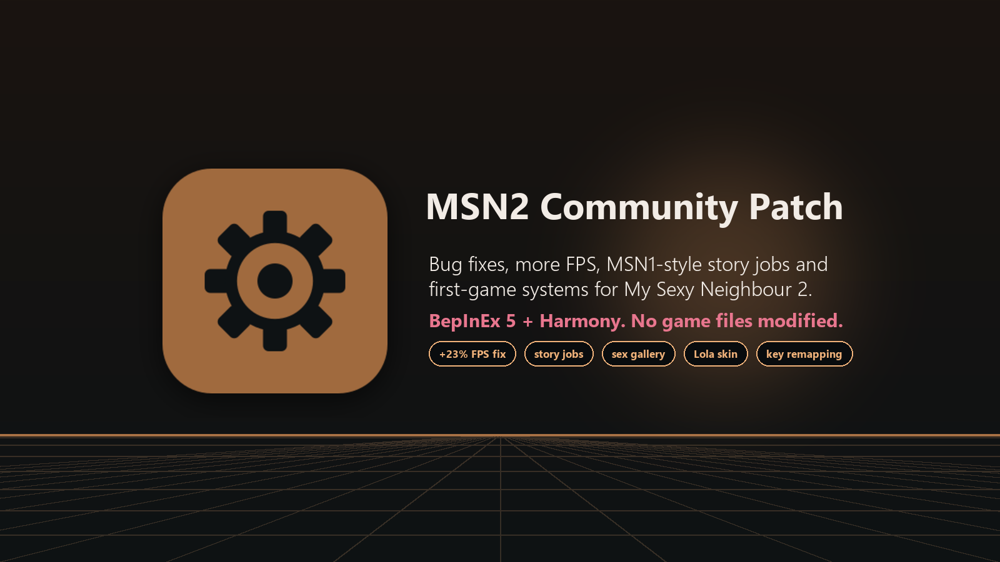
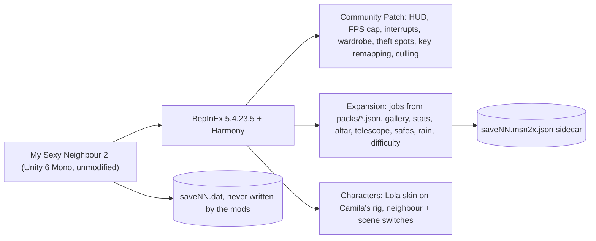

<div align="center">



[](https://github.com/SenjuWoo/MSN2-CommunityPatch/actions/workflows/validate.yml)
[](https://github.com/SenjuWoo/MSN2-CommunityPatch/releases/latest)
[](#install)
[](#how-it-works)
[](LICENSE)

**[Install](#install)** · **[The mods](#the-mods)** · **[Lola](#lola-replaces-camila-optional-plugin)** · **[First-game systems](#first-game-systems-expansion-050)** · **[Build](#build-from-source)** · **[How it works](#how-it-works)** · **[Changelog](CHANGELOG.md)**

</div>

Runtime mods for **My Sexy Neighbour 2** (Steam, Unity 6000.2.2 Mono), built on
BepInEx 5.4.23.5 and Harmony. The **Community Patch** fixes the bugs and
performance problems players hit most; the **Expansion** brings back what made
the first game, *My Sexy Neighbor*, work: story jobs with a client and bonuses,
a sex gallery with replay, statistics, a souvenir altar, a telescope, safe
cracking, rain and difficulty presets. The optional **Characters** plugin puts
Lola from the first game in Camila's place, adds switches for Yuka, Jamal and
Peter and their scenes, and restores Yuka's never-worn bunny suit. No game file is modified, and the game's own save is never written.

## What you get

- **A faster, steadier game.** The per-frame HUD exception is gone (151 -> 186 FPS, 1% lows 93 -> 133 on the test PC), Medium and Low are no longer hard-capped at 60 FPS, Low gets a real light budget, and about 330 off-screen prop animators pause (+4% average, +20% 1% lows).
- **Bugs fixed at the source.** NPCs no longer freeze forever on an ignored interrupt, the wardrobe no longer throws the player across the map at low FPS, and theft tasks skip the 12 spawn points sealed inside furniture.
- **Key remapping.** Settings > Controls goes live: click an action, press a key, conflicts swap, "Reset all keys" restores the defaults.
- **Story jobs, MSN1 style.** Journal, objective tracker, dialogue, main goals plus Souvenir / Hidden-Cam / Shadow / Timed bonuses, chained jobs and JSON job packs. Ships the 5-job *Neighbourhood Classics* pack and the *House Help* pack.
- **First-game systems.** Sex gallery with replay, statistics, souvenir altar, telescope, keypad safes, rain and Easy/Normal/Hard detection presets, each with its own switch.
- **Lola replaces Camila** (optional): body, face, hair, outfits, name and portraits, on Camila's own skeleton, so every animation, sex scene and photo still works.
- **Every fix can be switched off** in the config, and a fix that fails to apply leaves the original game behaviour in place and says so in the log.


## Install

1. Download the zips from the [latest release](https://github.com/SenjuWoo/MSN2-CommunityPatch/releases/latest):
   - `MSN2_CommunityPatch_v<ver>.zip`: BepInEx 5.4.23.5 (the mod loader, MIT) plus the patch. Install this first.
   - `MSN2_Expansion_v<ver>.zip`: story jobs and first-game systems. Needs BepInEx from the patch zip.
   - `MSN2_Characters_v<ver>.zip` (optional): Lola replaces Camila, plus the neighbour and scene switches.
2. Extract each zip into the game folder (the one with `My Sexy Neighbour 2.exe`), overwrite if asked.
3. Start the game normally. `BepInEx\LogOutput.log` shows each plugin's version and which fixes applied.

The readme inside each zip covers keys, settings and logs.

**Uninstall:** delete `BepInEx\plugins\MSN2\` to remove the mods and keep BepInEx, or delete `winhttp.dll`,
`doorstop_config.ini`, `.doorstop_version` and the `BepInEx` folder to remove everything. Saves are never
modified; Expansion progress lives in `saveNN.msn2x.json` beside the game save and the game save stays loadable
without it.

## The mods

| Mod | What it does |
|---|---|
| **MSN2 Community Patch** | Fixes the per-frame HUD exception (+23% FPS measured), the 60 FPS cap on Medium/Low, NPCs freezing on ignored interrupts, the Low preset light budget, the wardrobe interaction that threw the player off the map at low FPS, and theft spawn points inside furniture; adds graphics options, **key remapping** on Settings > Controls and off-screen animator culling. |
| **MSN2 Expansion** | MSN1-style story jobs: journal, objective tracker, dialogue, main goals + Souvenir / Hidden-Cam / Shadow / Timed bonuses, chained jobs, JSON job packs, saves beside the game save. Ships the 5-job *Neighbourhood Classics* pack. **First-game systems**: sex gallery with replay, statistics, souvenir altar, telescope, safe cracking, rain, difficulty presets. |
| **MSN2 Characters** (optional) | **Lola from the first game replaces Camila**: body, face, hair, outfits, name and portraits. Visual only, so schedules, scenes and saves are untouched; delete the DLL and Camila is back. Switches for **Yuka, Jamal and Peter** and their scenes; Yuka's unused bunny suit restored. |

### Keys and settings

| Key | Does |
|---|---|
| `J` | job journal; `Enter` accepts / turns in / skips dialogue, `,` `.` page through jobs |
| `G` | sex gallery: every finished sex scene, `Enter` replays it (no police during a replay) |
| `K` | statistics: photos, naked photos, thefts, traps, scenes, times spotted and caught, money |
| Settings > Controls | live key remapping, saved in `BepInEx\config\senjuwoo.msn2.bindings.json` |

| Config file (`BepInEx\config\`) | Sections |
|---|---|
| `senjuwoo.msn2.communitypatch.cfg` | `[Graphics]` VSync, FPS limit, MSAA, render scale, upscaler, shadows · `[Fixes]` one switch per fix · `[Performance]` AnimatorCulling, SmallObjectShadows · `[Debug]` |
| `senjuwoo.msn2.expansion.cfg` | `[Systems]` one switch per first-game system plus `Difficulty = Vanilla \| Easy \| Normal \| Hard` · `[Keys]` |
| `senjuwoo.msn2.characters.cfg` | `[Skins] Camila = lola` (empty = vanilla Camila) · `[Neighbours]` · `[Scenes]` |

## Lola replaces Camila (optional plugin)

`MSN2_Characters_v<ver>.zip` adds `MSN2Characters.dll` and `skins/lola/`. Lola's MSN1 meshes are re-bound onto Camila's skeleton at runtime and wear clones of Camila's own materials with Lola's textures, so every Camila animation, sex scene and photo works unchanged. Turn it off with `[Skins] Camila =` (empty) in `BepInEx\config\senjuwoo.msn2.characters.cfg`. The skin data is generated from the first game with `tools/charport/convert_skin.py`; only `skin.json` lives in git.

## Cut neighbours restored

Yuka (Emma's maid), Jamal (Camila's housemate) and Peter (Emma's husband) look cut, but they ship as residents of Camila's and Emma's houses with full schedules and couple scenes; they appear when the story opens those houses (`CUT_CONTENT.md` has the audit). MSN2 Characters adds per-neighbour and per-scene switches in `senjuwoo.msn2.characters.cfg` (`[Neighbours]`, `[Scenes]`, default on), restores Yuka's never-worn bunny suit for her evening shift, and the Expansion's *House Help* pack has a job for each of them.

## First-game systems (Expansion 0.5.0)

Sex gallery with replay (G), statistics screen (K), a souvenir altar in your room (+2% job money per trophy kind), a telescope at your window (5x phone zoom), keypad safes in Emma's house (Mastermind hints, cash + item), rainy spells (noise x0.6) and Easy/Normal/Hard detection presets. Each has a switch in `[Systems]` of `senjuwoo.msn2.expansion.cfg`.

## Build from source

Needs the game installed (assemblies are referenced from its `Managed` folder, never committed), .NET SDK 8+, and BepInEx 5.4.23.5 extracted to `vendor/BepInEx_5.4.23.5` (gitignored). The scripts find the game through Steam's library list; set `MSN2_GAME_DIR` if yours lives elsewhere.

```powershell
$env:MSN2_GAME_DIR = '<Steam library>\steamapps\common\My sexy Neighbour 2'   # only if auto-detection misses it
& '.\MSN2 Expansion 0.5.0\tools\build.ps1'
& '.\MSN2 Expansion 0.5.0\tools\package.ps1' -Version 0.5.0                     # writes dist\0.5.0\ (three zips)
node '.\MSN2 Expansion 0.5.0\tools\validate-packs.mjs' '.\MSN2 Expansion 0.5.0\packs'
```

`package.ps1` also needs the generated skin data (`tools/charport/convert_skin.py`) and the rain audio
(`tools/charport/extract_audio.py`); both come from the first game and stay out of git. `tools/relaunch.ps1`
and `tools/agent.ps1` drive the running game for tests (enable `[Debug] AgentBridge` in the patch config).
Job packs are plain JSON: [`docs/PACK_FORMAT.md`](MSN2%20Expansion%200.5.0/docs/PACK_FORMAT.md).

## How it works



- **Runtime only.** Harmony patches on the game's own methods; nothing in the game folder is replaced except the BepInEx loader files.
- **Fail safe.** Each fix applies on its own; one that cannot find its target logs it and leaves vanilla behaviour.
- **Packs are data.** The Expansion's jobs live in JSON packs checked by `validate-packs.mjs` in CI with the same rules as the in-game loader.
- **Release zips are payload only.** `package.ps1` refuses a zip that holds sources, scripts or build caches.

```text
CURRENT.txt                    active snapshot folder
MSN2 Expansion 0.5.0/
  src/MSN2CommunityPatch       patch plugin
  src/MSN2Expansion            expansion framework plugin (Systems/ = first-game systems)
  src/MSN2Characters           optional skins plugin (Lola replaces Camila)
  skins/lola/skin.json         skin definition (meshes/textures are generated, not in git)
  tools/charport/              MSN1 -> MSN2 character converter (UnityPy) + .msnm format
  packs/                       job packs (docs/PACK_FORMAT.md)
  tools/                       build / install / launch / agent / package scripts
  MODDING_PLAN.md              verified recon of the game
  ARCHITECTURE.md              design, save compatibility, extension points
  TEST_RESULTS.md              in-game test evidence
  TASKS.md                     done / partial / blocked
  CUT_CONTENT.md               cut-content audit (0.4.0)
MAP.md                         full project map: code, runtime paths, tools, release steps
```

Older `MSN2 Expansion <version>/` folders are frozen copies of earlier releases.

## Tested

Every release is played in game before it ships: `TEST_RESULTS.md` in the snapshot records each fix and
system with its measurements. CI (`validate`) checks the job packs and that no decompiled game code,
vendor files or personal paths are committed; CodeQL scans the C# and the pack validator. No in-game
screenshots are published in this repository.

## Licence

MIT (this repository). BepInEx is MIT and bundled unmodified in the patch archive. My Sexy Neighbour 2 and My Sexy Neighbor belong to their developers. Nothing from either game is in this repository; the Characters release archive contains Lola's meshes and textures converted from My Sexy Neighbor.
